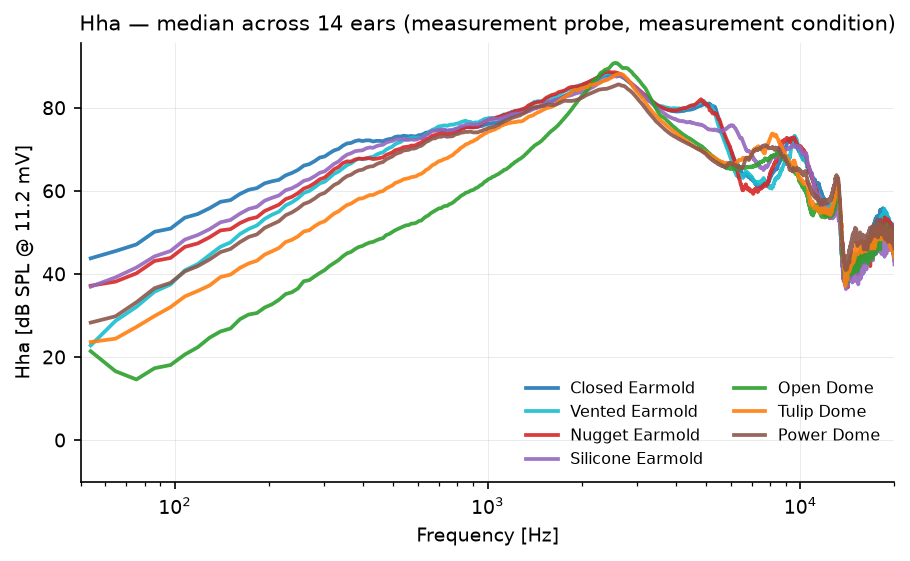
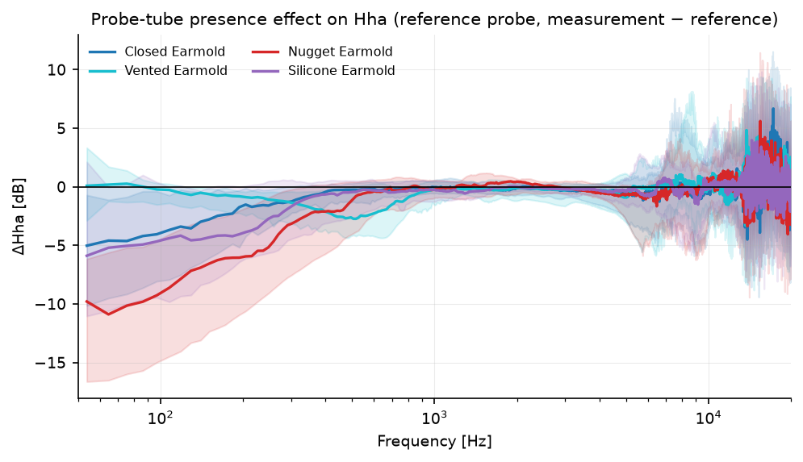

# AcousticBench

**Electroacoustic Measurement, Validation & Reporting Toolkit**

An industrial-style, reproducible research toolkit for hearing-aid real-ear
measurement analysis, signal-processing validation and automated engineering
reports. AcousticBench combines physics-aware measurement code, subject-level
statistics, a virtual hearing aid, a 1000-case synthetic validation suite, a
nine-page Streamlit research dashboard, PDF/Excel/HTML reporting and an
independent MATLAB implementation.

[](https://github.com/example/AcousticBench/actions)
[](pyproject.toml)
[](LICENSE)
[](DATA_LICENSE.md)

> **Scope.** This is an engineering/research toolkit. It performs a secondary
> analysis of an openly published dataset and validates algorithms on
> synthetic signals. It is **not** a medical device, not a clinical validation,
> and not a substitute for audiological fitting or regulatory testing. See
> [limitations](docs/limitations.md).

---

## What it does

* **Physics-aware data layer** for the Denk, Hackenberg & Husstedt (2026)
  probe-tube dataset: 2049 frequency bins × 14 earpiece/condition codes ×
  14 ears × 3 reinsertions, with explicit separation of **measured NaNs** and
  **structurally invalid** values — never imputed.
* **Measurement science**: `Hha`, real-ear unaided/occluded/insertion gain,
  acoustic feedback, probe-to-probe bias, probe-tube presence effect and
  threshold analysis, with subject-level statistics, effect sizes, bootstrap
  95 % CIs, Holm correction and ICC reliability.
* **DSP**: FFT, STFT, Welch PSD, FIR/IIR design and filtering, gain, SNR, THD,
  THD+N and H1 frequency-response estimation.
* **Virtual hearing aid**: multiband feed-forward compression with
  attack/release, additive noise and six deterministic fault types.
* **Synthetic validation**: a deterministic 1000-case suite with analytic,
  waveform-derived ground truth and documented reference conditions.
* **MATLAB + Python**: an independent MATLAB implementation, unit tests, a
  programmatic GUI and a cross-language export contract.
* **Interfaces**: CLI (`acb`), nine-page Streamlit dashboard and PDF/Excel/HTML
  report generation.

## Results at a glance

All real-data results below were produced by `bash scripts/run_experiments.sh`
on the public dataset; all synthetic results by the deterministic suite. Full
details: [docs/experiments.md](docs/experiments.md), machine-readable artefacts
in [`results/experiments/`](results/experiments/).

### Real data (14 ears)

| Finding | Value |
|---|---|
| `Hha` at 1 kHz, closed earmold / open dome | **76.1 / 62.7 dB SPL** at 11.2 mV drive |
| `Hha` peak near 2 kHz | ≈ 84–86 dB SPL |
| Real-ear unaided gain at 1 / 2 / 4 kHz | **+0.6 / +14.0 / +15.7 dB** (ear-canal resonance) |
| REOIG at 1 kHz, closed earmold / open dome | **−10.7 / +0.1 dB** |
| Probe-to-probe bias, 0.5–4 kHz (MPT−RPT) | **≈ −1.5 dB** (systematic; reported, not removed) |
| Probe-tube presence effect, ΔHha at 100 Hz (nugget) | **−8.6 dB** (closed −3.7, silicone −4.4) |
| Probe-tube presence effect, ΔREOIG at 1 kHz (nugget) | **+6.1 dB** |
| Threshold PTPE, ΔT at 125 Hz (closed, nugget, power dome) | **−3.9, −6.0, −5.3 dB** |
| Reinsertion repeatability, SD 0.5–4 kHz | median **0.38 dB** (RC ≈ 1.1 dB; ICC(2,1) 0.77–0.98) |
| Closed vs open `Hha` at 1 kHz | **+12.45 dB**, p = 8.4 × 10⁻⁹ (paired, n = 14) |

These directions and magnitudes reproduce the source study, which validates the
validity model implemented in AcousticBench.

### Synthetic validation (1000 cases, 4 × 250)

| Metric | Reference-condition target | Measured (reference) |
|---|---|---|
| Gain error | ≤ 0.1 dB | max **5.3 × 10⁻¹⁵ dB** |
| SNR error | ≤ 0.5 dB | max **0.0105 dB** (residual estimator) |
| THD error | ≤ 0.1 percentage points | max **3.5 × 10⁻¹³ pp** |
| Frequency-response MAE | ≤ 0.5 dB | median **0.016 dB**, max **0.069 dB** |
| Dynamic compression | measured vs configured | ratio **3.00 vs 3.0**; static curve error **≤ 0.015 dB** |
| Fault injection | detected within tolerance | **6/6** faults, mean relative error **0.001 %** |

Targets are evaluated only in the explicitly documented reference conditions;
wider-range results are reported separately and never silently excluded.

### Figures





---

## Verification status (honest)

| Component | Status |
|---|---|
| Python core (data, measurements, stats, DSP, virtual HA, synthetic, experiments, validation) | **Executed and tested** — 557 tests passed (unit + integration + regression), 91.37 % total coverage (core packages 93.9 %) |
| E01–E16 experiments | **Executed**; artefacts committed under `results/experiments/` |
| Data audit | **Executed** on the real 90 MB dataset; 0 errors, 0 warnings |
| Synthetic target compliance | **Met** under the documented reference conditions |
| Streamlit dashboard | Headless smoke test (server + health endpoint); interactive browsing not automated |
| PDF / Excel / HTML reports | **Generated** from saved results; see `reports/` |
| **MATLAB implementation, tests and GUI** | **Authored but NOT executed/verified** — MATLAB is not installed in the build environment. See [docs/matlab_status.md](docs/matlab_status.md). |
| MATLAB–Python agreement (E15) | MATLAB side **not run**. An independent MATLAB-transcribed Python port agrees with the production implementation (max \|Δ\| ≈ 10⁻¹⁴ dB on band levels). This is *not* a MATLAB execution claim. |

## Quickstart

### 1. Install

```bash
git clone <your-fork-url> AcousticBench
cd AcousticBench
bash scripts/install.sh          # creates .venv, installs the package + dev tools
```

or manually:

```bash
python3.12 -m venv .venv
source .venv/bin/activate
pip install -e ".[dev]"
```

### 2. Get the data (not redistributed)

```bash
python scripts/fetch_data.py     # downloads Data.mat + Documentation.pdf from Zenodo,
                                 # verifies SHA-256 45cf5eeb…33e48
```

Data licence: **CC BY 4.0** — see [DATA_LICENSE.md](DATA_LICENSE.md).

### 3. Verify, audit, run

```bash
python scripts/verify_install.py         # import + dataset + smoke checks
acb audit                                # data-quality audit → results/audit/
bash scripts/run_experiments.sh          # E01–E16 → results/experiments/
bash scripts/run_tests.sh                # pytest (unit + integration + regression)
acb report                               # PDF + Excel + HTML → reports/
```

### 4. Dashboard

```bash
bash scripts/start_dashboard.sh          # http://localhost:8501
# or: acb dashboard --port 8501
```

Nine pages: **Data Explorer, Frequency Response, Acoustic Feedback,
Repeatability, Hearing Threshold, Statistical Analysis, Signal Laboratory,
Validation, Report Center** — interactive filters, Plotly curves and heatmaps,
virtual hearing-aid controls and one-click report downloads.

### 5. CLI overview

```text
acb inspect                    # schema, dimensions, dtypes, SHA-256
acb audit                      # full audit (JSON/Markdown/CSV/PNG)
acb experiments [--codes E01 E02]
acb report [--formats pdf excel html]
acb validate                   # cross-language validation (E15)
acb dashboard --port 8501
```

## Project structure

```text
AcousticBench/
├── src/acousticbench/        # installable package (src layout)
│   ├── types.py              # device/container metadata + validity rules
│   ├── config.py             # typed YAML configuration
│   ├── io/                  # MAT v5/v7.3 loading + provenance
│   ├── data/                # dataset, TransferCube, units, validity, audit
│   ├── measurements/        # Hha, REOG/REUG/REOIG, PTPE, thresholds, reliability
│   ├── stats/               # paired tests, bootstrap, effect sizes, Holm/BH, ICC
│   ├── dsp/                 # FFT/STFT/PSD, filters, gain/SNR/THD/H1
│   ├── virtual_ha/          # multiband compressor, noise, faults
│   ├── synthetic/           # 1000 deterministic cases + ground truth
│   ├── experiments/         # E01–E16, runner, registry
│   ├── validation/          # MATLAB-transcribed port + cross-language exchange
│   ├── report/              # PDF (reportlab), Excel (xlsxwriter), HTML (jinja2)
│   └── cli.py               # `acb` entry point
├── app/                     # Streamlit dashboard (9 pages)
├── matlab/                  # independent MATLAB implementation, GUI, tests
├── config/default.yaml      # single source of configuration
├── tests/                   # unit / integration / regression
├── scripts/                 # install, fetch-data, verify, test, run, dashboard
├── results/                 # audit, experiments, validation, synthetic manifests
├── reports/                 # generated PDF/Excel/HTML
├── docs/                    # architecture, algorithms, data, experiments, limits
└── .github/workflows/       # CI + manual data-dependent experiment workflow
```

## Data model in one paragraph

`Data.mat` stores complex frequency-domain transfer functions as
`frequency × device × subject × reinsertion`, with device codes 1–14
(7 earpiece families × reference/measurement probe condition), 14 subjects and
3 reinsertions. Two kinds of invalid data exist and must not be conflated:
**measured NaNs** (18 wholly invalid sessions; thresholds: 19) and
**structurally invalid** values that exist numerically but are not the intended
physical quantity (measurement probe loose in the reference condition;
reference probe absent for domes). AcousticBench masks both, never imputes, and
encodes the rules in one place (`types.ContainerSpec`). Read
[docs/data.md](docs/data.md) for units, validity matrix and the in-situ
free-field inference.

## Requirements

* Python ≥ 3.10 (developed on 3.12), NumPy, SciPy, Pandas, h5py, PyYAML,
  Matplotlib, Plotly, Streamlit, Jinja2, ReportLab, openpyxl, xlsxwriter.
* MATLAB R2021b+ for the MATLAB part (not required for the Python toolkit).
* No GPU, deep learning or external AI APIs are used.

## Configuration

Everything is driven by [`config/default.yaml`](config/default.yaml): paths,
master seed, analysis bands, alpha, bootstrap settings, synthetic ranges and
targets, per-experiment parameters, dashboard defaults and report options.
Override with `acb --config my.yaml …` or `ACOUSTICBENCH_CONFIG=my.yaml`.

## Reproducibility

* One master seed (`20260422`) seeds bootstrap, synthetic suite and fault/noise
  generation; all experiment artefacts record it.
* Every experiment writes `result.json`, `summary.md`, `config_snapshot.json`,
  tidy `tables/*.csv` and `figures/*.png`.
* The dataset is identified by SHA-256 and full provenance metadata in the audit.
* The 1000-case synthetic manifest is committed under
  `results/synthetic/manifest.{csv,json}`.

## Tests and CI

```bash
bash scripts/run_tests.sh
PYTHONPATH=src .venv/bin/python -m pytest tests -q --cov=acousticbench --cov-report=term
```

The suite includes unit tests (config, I/O, data validity, measurements,
statistics, DSP, virtual HA, synthetic cases, experiments, validation), integration
tests and real-data regression tests. CI runs the data-free subset on Python
3.10–3.12; a manual workflow downloads the CC BY 4.0 dataset and runs all
experiments.

## MATLAB

The `matlab/` directory contains an independent BSD-style MATLAB implementation
(namespace `+acousticbench`), a programmatic `uifigure` GUI and
`matlab.unittest` tests. **It has not been executed in this environment**
because MATLAB is not installed; this is documented explicitly in
[docs/matlab_status.md](docs/matlab_status.md). `matlab/run_cross_language_export.m`
implements the E15 contract (`results/validation/matlab_inputs.mat` →
`results/validation/matlab_reference.csv`) so the comparison can be run by
anyone with MATLAB.

## Documentation

| Document | Contents |
|---|---|
| [docs/data.md](docs/data.md) | Dataset provenance, axes, units, validity matrix, audit findings |
| [docs/architecture.md](docs/architecture.md) | Layered design, data flow, artefact contract, extension points |
| [docs/algorithms.md](docs/algorithms.md) | Equations for measurements, statistics, DSP, virtual HA, synthetic GT, cross-language |
| [docs/experiments.md](docs/experiments.md) | E01–E16 methods, actual results and artefacts |
| [docs/limitations.md](docs/limitations.md) | Scope, statistical and metrological limitations, MATLAB status |
| [docs/matlab_status.md](docs/matlab_status.md) | Explicit MATLAB verification status |

## Citation

If you use this toolkit, please cite the software and the underlying dataset:

```bibtex
@software{acousticbench2026,
  title = {AcousticBench — Electroacoustic Measurement, Validation & Reporting Toolkit},
  year = {2026},
  version = {0.1.0},
  license = {MIT},
  url = {https://github.com/example/AcousticBench}
}

@misc{denk2026dataset,
  author = {Denk, Florian and Hackenberg, Lea and Husstedt, Hendrik},
  title = {Original data for: "On the effect of probe tube presence on measured
           hearing aid transmission behavior"},
  year = {2026},
  publisher = {Zenodo},
  doi = {10.5281/zenodo.20023285}
}
```

## Licence

* **Code:** MIT — see [LICENSE](LICENSE).
* **Data:** CC BY 4.0, owned by the dataset authors — see
  [DATA_LICENSE.md](DATA_LICENSE.md). Raw data files are not committed.

## Contributing

Contributions are welcome. Please keep the project’s core principles: no
imputation, explicit validity, subject-level statistics, honest verification
status, reproducible seeds and documented limitations.
